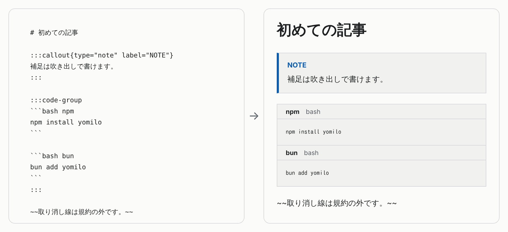
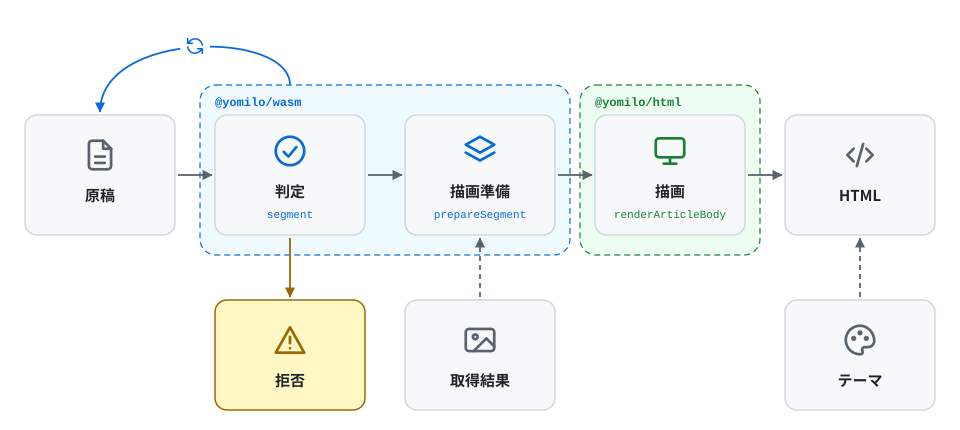

<p align="center">
  <br>
  <br>
  <picture>
    <source media="(prefers-color-scheme: dark)" srcset="assets/logo-dark.svg">
    <source media="(prefers-color-scheme: light)" srcset="assets/logo-light.svg">
    
  </picture>
  <br>
</p>
<p align="center">
  <a href="https://github.com/RateteDev/yomilo/releases/latest"></a>
  <a href="LICENSE"></a>
</p>
<p align="center">
  日本語 ・ <a href="docs/readme/README.en.md">English</a>
</p>
<br/>

# Yomilo

AIエージェントの出力や記事を画面に表示したい開発者へ、厳格なMarkdownを読みやすいHTMLにする部品を届けます。
書きかけの原稿でも、確定した要素から順に描けます。

- 🧱 乱れた要素だけを取り分け、ほかの要素は描き続ける
- ⚡ 生成途中の原稿から、確定した要素を順に表示する
- 🧩 吹き出し・コードの切替・図・画像・動画・リンクカードを記法で書ける
- 🎨 本文のHTMLとテーマを分けて配る
- 🦀 Rustの中核をWASMで包み、Node・Bun・Workers・ブラウザで動かす

## 解決する課題

| 課題 | Yomiloの答え |
| --- | --- |
| AIの出力は記法が揺れ、1か所の乱れで全体が崩れる | 要素ごとに判定し、乱れた要素だけを拒否する |
| 生成中の文章を、完成より先に読ませたい | 確定した要素から順に描き、描いた要素は続きが届いてもそのまま保たれる |
| 標準のMarkdownより豊かに表現したい | 吹き出し・コードの切替・図・画像・動画・リンクカードをディレクティブで書く |
| 見た目は利用側で自由に作りたい | 本文のHTMLだけを返し、テーマは別に配る |

## 例

<p align="center">
  <picture>
    <source media="(prefers-color-scheme: dark)" srcset="assets/example-dark.png">
    <source media="(prefers-color-scheme: light)" srcset="assets/example-light.png">
    
  </picture>
</p>

取り消し線の行は規約の外なので原文のまま取り分けられ、ほかの要素は整って描かれます。

## 仕組み

<p align="center">
  <picture>
    <source media="(prefers-color-scheme: dark)" srcset="assets/how-it-works-dark.svg">
    <source media="(prefers-color-scheme: light)" srcset="assets/how-it-works-light.svg">
    
  </picture>
</p>

1. **判定**: 原稿を文書直下の要素ごとのセグメントに分け、確定したものを返します。
2. **描画準備**: 画像やカードの取得結果、コードの色の役割などを各セグメントへ加えます。
3. **描画**: セグメントを本文のHTMLに組み、題・見出し・診断も返します。

語彙の定義は[用語集](docs/用語集.md)にあります。

## インストール

パッケージは[GitHub Releases](https://github.com/RateteDev/yomilo/releases)のtarballで配っています。

```sh
# 中核のWASMとHTMLの描画部を導入する（版はReleasesの最新に合わせる。例はv0.1.0）
bun add https://github.com/RateteDev/yomilo/releases/download/v0.1.0/yomilo-wasm-0.1.0.tgz https://github.com/RateteDev/yomilo/releases/download/v0.1.0/yomilo-html-0.1.0.tgz
# 最小テーマのCSSを使うときに導入する
bun add https://github.com/RateteDev/yomilo/releases/download/v0.1.0/yomilo-theme-0.1.0.tgz
```

## 使い方

```ts
import { renderArticleBody } from "@yomilo/html/engine";
import { defaultPreparationInputs, prepareSegment, segment } from "@yomilo/wasm";

const source = await Bun.file("article.md").text();
// 判定: 原稿を要素ごとのセグメントに分ける
const { segments } = segment(source, null, "complete");
// 描画準備: 取得結果が空の既定の入力を使う
const inputs = defaultPreparationInputs();
// 描画: 本文のHTMLと題・見出し・診断を得る
const { html, title, diagnostics } = renderArticleBody(segments.map((s) => prepareSegment(s, inputs)));
```

`@yomilo/html`はTypeScriptのソースで配るため、BunやバンドラーなどTypeScriptを扱える環境で使います。
本文のHTMLだけを返すので、CSS・操作・目次・ページの枠は利用側で自由に付けられます。
WorkersとブラウザでのWASMの読み込みは[別の文書](docs/WorkersとブラウザでのWASM.md)にまとめています。

## テーマ

`@yomilo/theme/minimal.css`は、本文のHTMLへそのまま当てられる最小のテーマです。
環境の書体を使い、ライトとダークの配色に対応します。

## 記法

原稿は厳格なMarkdownで書きます。

- 見出し(h1〜h3)・段落・強調・インラインコード・リンク・箇条書き・番号付きリスト・引用・表・コード・区切り線を使えます。
- 吹き出し・コードの切替・図・画像・動画・リンクカードは、ディレクティブで書きます。
- 脚注・取り消し線・タスクリスト・Markdownの画像記法・生のHTMLを含む要素は、拒否されたセグメントとして原文と診断が返り、ほかの要素の描画は続きます。

## ライセンス

[MIT License](LICENSE)
