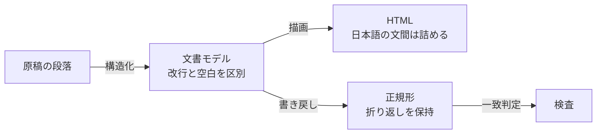

# 段落内の軟改行を情報として保持し表示の判断を描画側へ委ねる

## 背景

構造化は段落内の軟改行を空白へ置き換えて文書モデルへ入れていたため、原稿をどの位置で折り返したかの情報が失われていた。
日本語は語間に空白を持たないので、書き手の環境が文単位で原稿を折り返すと、表示では文と文の間に意図しない隙間が現れた。
表示カタログを整文した原稿では文と文の間に1字分の隙間が出て、表示側は消すことも残すこともできなかった。

## 判断

### 軟改行を空白へ変換せず文書モデルへ保持する

段落内の軟改行は文字として保持し、文書モデルで改行と空白を区別する。
日本語の文間に空白を生ませないための判断は、意味を解釈する構造化ではなく、文字を並べる描画の側で行う。

**根拠**

- 同じ原稿から描く環境が複数あり、語間へ空白を挿入するかの判断は文字を並べる層に一度だけ置ける。
- 構造化で空白へ置き換える案は、表示環境ごとに同じ判断を持たせ、日本語の詰めを知らない環境に隙間を残す。
- 改行を落とすと、後から見分ける手掛かりが表示環境に残らない。

### 正規形は折り返しを保って書き戻す

正規形の書き戻しは段落の折り返しを保持し、1行へ潰さない。

**根拠**

- 文書モデルが保持した軟改行を書き戻しで捨てると、保持した情報が正規形で再び失われる。
- 1行へ潰す案は、書き手が折り返した原稿とエンジンの正規形が別の形を指すことになる。
