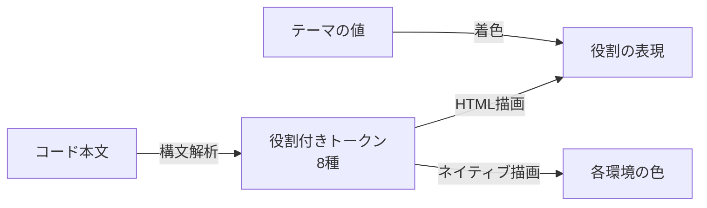

# コードの色付けは役割を運び色はテーマが与える

## 背景

コードの色付けは、色を値として出力へ焼き込むか、意味を構造として運ぶかの選択がある。
色付けの設定が環境ごとに別々に定義され、同じ原稿の見た目が環境でずれた経緯がある。
テーマごとに明暗が分かれ、暗い配色を明るいテーマへ流用すると読めなくなる。

## 判断

### トークンは色ではなく役割を持つ

構文解析はトークンへ役割（コメント・予約語・文字列など）を付けて文書モデルへ入れる。
同じ語に同じ役割が付くことを保ち、文法エンジンによる分割位置の揺れは許容する。

**根拠**

- 色を値として運ぶと、どこで決まった色かを原稿から追えない。
- 役割なら表示環境が自分のテーマで塗れ、明暗の別を描画側が吸収できる。
- 分割位置の差は意味の差ではなく、語と役割の対応を保てば同じ意味を運べる。

### 細かいスコープは持たず役割の下へ足せる形にする

文法エンジンが返す細かいスコープは文書モデルへ入れず、役割だけを運ぶ。
役割は細かいスコープを包む集合として定め、特定のスコープだけを塗り分けたい環境が現れたときに役割の下へ足せる形に保つ。

**根拠**

- 細かいスコープを使う表示環境がまだ無く、いま運んでも使われない。
- 役割と細かいスコープを両方運ぶ案は、後から足せる情報を先に入力の契約へ固定する。

### 認識する言語と別名を明示し未知の言語名は色なしで通す

色付けできる言語とその別名は明示した一覧として持ち、どの環境でも同じ言語に役割が付くようにする。
一覧に無い言語名は拒否せず、書かれた言語名を保持したまま役割を付けずに色なしで描く。

**根拠**

- 未知の言語名を拒否すると、書き手が一覧に無い言語を書くたびに文書ごと止まる。
- 言語名を保持すれば、色が付かなくても何のコードかという情報は失われない。
- 認識する範囲が環境ごとに違うと、同じ原稿で役割の付く言語が変わる。

### 描画は役割をマークアップへ残し色はテーマが塗る

HTMLには役割を1つの表現で出し、色は所有するスタイルがテーマの値で塗る。
描画の実装は特定の色を持たない。

**根拠**

- 役割を出力へ残せば、配色の差し替えで本文と構造を変えずに済む。
- 役割をクラスと属性の二重で持つ案は、更新が片方へ届かない。
