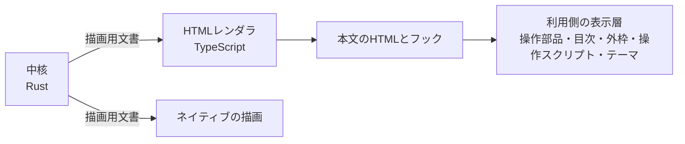

# HTMLレンダラをエンジン本体とは別の配布物として持つ

## 背景

同じ厳格Markdownから、サイトのページ・配布用の単体HTML・ネイティブ表示を同じ意味で描く必要がある。
HTMLの構造はTypeScriptで組み立てる方が扱いやすく、中核のRustとは配布言語と更新の周期が異なる。
HTMLで描く利用先が最も多いと見込まれ、同じ本文の描画を利用先ごとに作り直させない置き場が要る。
一方で、操作部品・目次・ページの外枠・操作スクリプト・テーマは、サイトとCLIで求める形が異なる。

## 判断

### HTMLレンダラを独立した成果物とし中核は描画用文書までを担う

HTMLレンダラは中核と同じレポジトリの別の配布物に置き、中核は描画用文書までを担う。
HTMLレンダラは中核とは別に導入するものとし、利用先が別の描画へ差し替えられるようにする。

**根拠**

- HTMLの組み立てはTypeScriptが扱いやすく、中核の言語と配布サイクルが違う。
- 分ければネイティブ実装は中核だけを使い、HTMLを持ち込まずに済む。
- 中核へ同梱する案は、中核だけがHTMLという1つの媒体を抱え、他の媒体と非対称になる。
- 利用先のレポジトリに置く案は、HTMLで描く他の利用先が同じ本文の描画を作り直すことになる。

### HTMLレンダラは本文のHTMLとフックまでを出す

HTMLレンダラが出すのは、本文のHTMLと、書き手の意図や取得の状態を表す属性（フック）までとする。
操作部品、アイコン、目次、ページの外枠、操作スクリプト、テーマの契約は、利用側の表示層が持つ。

**根拠**

- 操作と見た目はサイトとCLIで求める形が異なり、上流に置くと特定の利用先の形が全利用先の前提になる。
- フックが残れば、利用側は本文の構造を作り直さずに操作と見た目を足せる。
- ネイティブ表示はHTMLの操作部品を使わないため、本文の描画と同じ配布物にする理由がない。

### 操作の作法は利用側に置き書き手の意図は文書モデルに置く

コピーや折り返しの切替のように書き手が書いていない作法は利用側の表示層が持ち、折りたたみ・拡大・ラベルのように書き手が書いた意図は文書モデルへ入れる。

**根拠**

- 意図はどの環境でも同じ意味を持ち、作法は環境ごとに変わる。
- 作法を文書へ入れると、環境の違いが入力仕様へ漏れる。

### 構造と意匠を分けて配る

HTMLの構造とclass・属性はHTMLレンダラが持ち、色・余白・書体の値はテーマが持つ。
同じ構造を別の値で描けるようにする。

**根拠**

- 利用先ごとに変換器を持った時期に、同じ原稿から12件の差異が2026-10-11の比較で見つかった。
- 意匠を値へ分ければ、配布先が自分の見た目を持てる。
