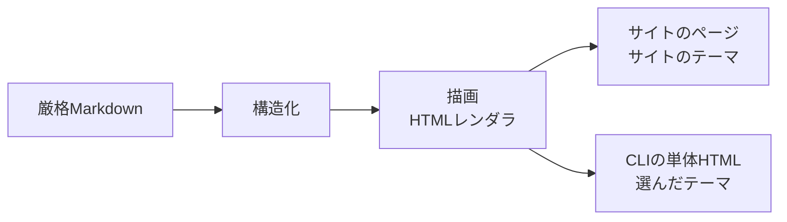

# 描画が保証するのは構造と意味であり見た目の一致ではない

## 背景

記事の描画は、かつてwebとCLIで別々の変換器を持ち、同じ原稿から12件の見た目の差異が出た。
差異の原因は変換の定義の二重化であり、以来「同じ見た目になること」まで保証の目標に掲げてCSSを共有してきた。
その結果、移設の時点でサイトの意匠と書体が描画本体へ入り、本体が特定サイトの見た目を前提にする状態になった。
一方でCLIは、書き手に構造を書かせ決定的な仕組みが描くための道具であり、サイトの見た目を再現する道具ではない。

## 判断

### 保証するのは構造と意味に限る

同じ原稿が同じ構造・同じ意味になることを保証し、見た目が一致することは保証しない。
見た目は利用先が選ぶテーマが決める。

**根拠**

- 揃えるべきは原稿の解釈であり、過去の12件の差異も変換器の二重化から生じた。
- 見た目の一致を目標に据えると、利用先ごとの意匠を上流へ持ち込むことになる。
- 利用先はそれぞれ別の目的を持ち、同じ見た目を必要としない。

### HTMLレンダラは描画の一例でありWebではそのまま使える

HTMLレンダラは描画用文書の描き方の一例として配り、Webで描く利用先はそのまま使えるものとする。
HTMLレンダラが出すのはHTMLの構造と、スタイルを当てるためのclassと属性までとし、描画の都合を足すのは利用先の仕事とする。

**根拠**

- 構造とclass・属性が定まらなければ、利用先はスタイルを当てられない。
- 見た目の規則まで上流に置くと、特定の利用先の都合が描画の前提になる。
