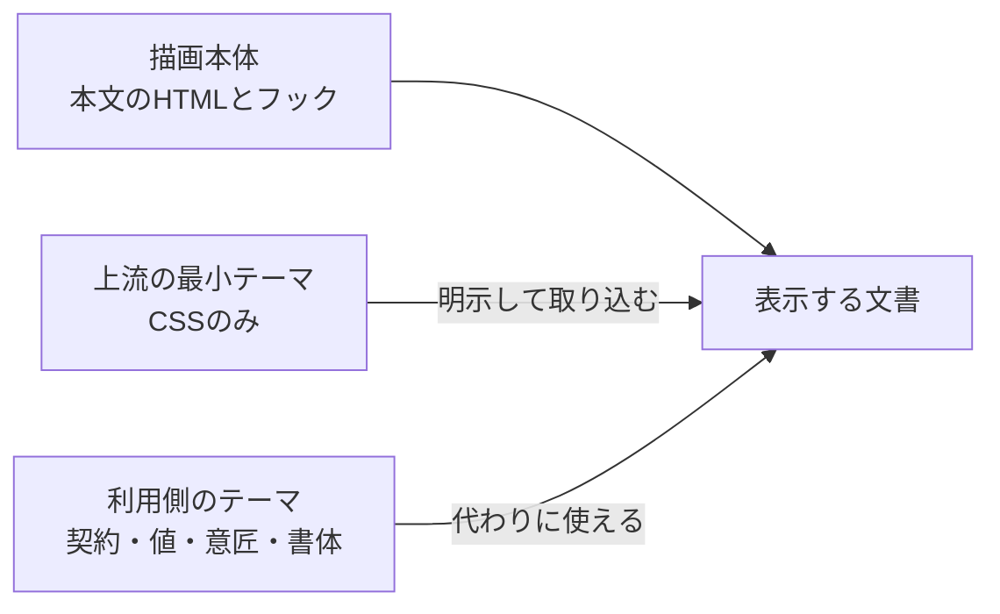

# 既定テーマを描画本体とは別の成果物として配る

## 背景

移設の時点では、描画に使うCSSが1系統しか無かったため、サイトの意匠がそのまま描画本体の既定になった。
描画本体が特定の意匠を持つと、利用先が自分の見た目を持てず、書体やテーマの名前まで本体へ固定される。
どの原稿でも読める形を保証しつつ、見た目は利用先が決められる必要がある。

## 判断

### テーマを別の成果物として持つ

上流のテーマは、本文のHTMLのclassと属性へ当てるCSSとし、描画本体とは別の成果物として配る。
使う側が明示して取り込み、描画本体はテーマを暗黙に読み込まない。
既定のテーマは、利用先が独自のスタイルを定義するときの参考にもなる。

**根拠**

- 値と意匠は、更新の周期も利用の有無も構造と異なる。
- 明示して取り込めば、使わないテーマの資産を配布物へ含めずに済む。
- 小さな実例があれば、利用先は自分のテーマを書き始めやすい。

### 既定のテーマは最小にする

既定のテーマは、環境の書体を用いた最小の見た目を与えるCSS1枚とし、書体のバイトもテーマの契約も持たない。
サイトの見た目と、テーマを差し替えるための契約は、利用側の表示層が担う。

**根拠**

- 既定の役割は、どの原稿も読める状態を与えることである。
- 第三者書体の原本と容量を上流へ持ち込むと、配布物の条件が増える。
- 契約は差し替えの仕組みを持つ表示層でしか使われず、上流に置いても使う側がない。

### 描画本体はCSSを持たない

描画本体は本文のHTMLとフックだけを出し、CSSを持たない。
最小テーマを外しても本文の構造と意味は失われず、見た目は利用側が決める。

**根拠**

- 構造のCSSを本体に残すと、利用側のテーマと重なり、どちらが効いているかを追いにくくなる。
- 本体がCSSを持たなければ、テーマの差し替えで本体の更新を待たずに済む。
