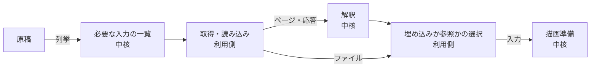

# 描画準備の入力はコアが列挙と解釈を担い取得と埋め込みは利用側が選ぶ

## 背景

描画準備には、画像・動画の渡し方と、URLカード・ツイートカードの取得結果を入力として渡す。
中核は原稿が何を必要とするかを答えなかったため、利用側は記事のディレクトリの全ファイルを読み、描画準備を2回実行して必要なカードを探していた。
OGPのHTMLとツイートの応答の読み方はTypeScriptの取得処理にあり、TypeScriptを使えない環境は同じ読み方を書き直す必要があった。
下流には、サイト、単体HTMLを作るCLI、将来のモバイルがあり、どの要素を埋め込みどれを参照にするかの望みがそれぞれ違う。

## 判断

### 中核は必要な入力を列挙し取得した応答を解釈する

中核は原稿から、必要な画像・動画の名前とカードのURLを列挙する。
取得したページのHTMLとツイートの応答から、カードの内容を読むのも中核が担う。
どちらもファイルの読み込みも通信も行わない。

**根拠**

- 列挙と解釈は計算であり、中核に置けばどの環境でも同じ結果になる。
- 取得と読み込みを中核に入れると、ブラウザやモバイルで同じように動くという中核の性質が失われる。
- 利用側が全ファイルを読む方法や描画準備を2回実行する方法は、使わない素材を読み、処理を重ねる。

### 埋め込みか参照かは利用側が要素ごとに選ぶ

本文の画像・動画、URLカードのアイコン、ツイートのアバターと添付は、要素ごとに参照か埋め込みかを入力で選べる。
中核は既定を持たず、渡し方の無い本文の画像と動画は不足として報告する。
取得処理はアイコンの取得元のURLと中身の両方を返し、ツイートの画像は参照で返して、埋め込む利用側が差し替える。

**根拠**

- サイトは参照で小さく配り、単体HTMLは埋め込んでどこでも開け、モバイルは小さな画像だけを埋め込むといった使い分けが要る。
- 既定を持たなければ、利用側の意図しない渡し方が黙って選ばれない。
- 取得元のURLを残せば、取得した後でも参照へ切り替えられる。
