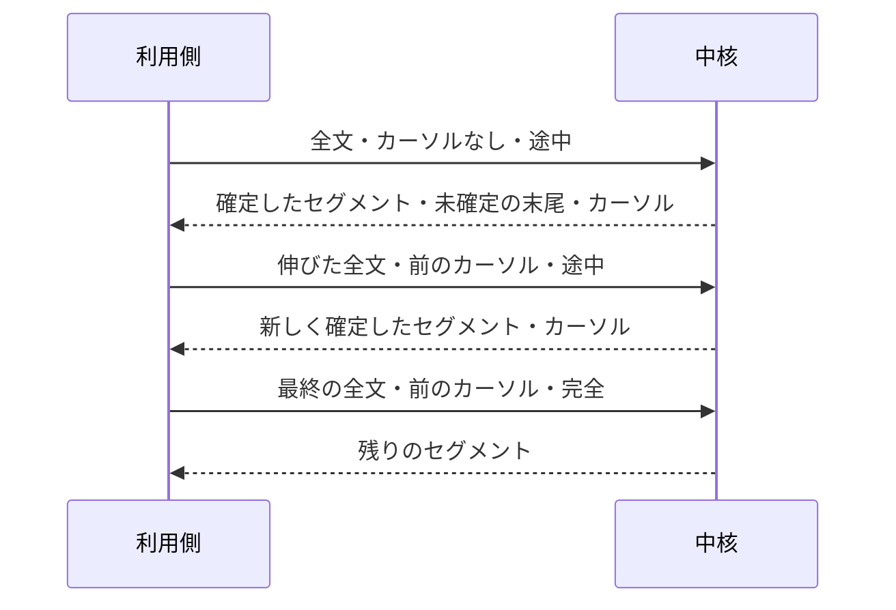

# 原稿を文書直下の要素ごとのセグメントで判定し確定し描画準備する

## 背景

構造化は原稿全体を1回で判定し、1か所でも規約に反すると文書全体を拒否していた。
チャットでは、モデルが句点の直後で強調を閉じた1か所のために、回答全体が整った表示を失った。
LLMの出力は少しずつ届くが、Markdownには閉じたことを示す記法が無く、後から届く行が前の解釈を変えるため、届いた分をそのまま描くと表示が組み替わる。
規約違反の扱いと逐次の配信を、同じ単位の上で扱えるようにするために検討した。

## 判断

### 文書直下の要素1つをセグメントとし規約の判定をこの単位で行う

見出し・段落・リスト全体・表・コード・ディレクティブ・前付けなど、文書の直下にある要素1つを**セグメント**とする。
規約に反したセグメントは原文と診断を持つ拒否されたセグメントになり、他のセグメントはそのまま受け入れる。
文書全体を拒否したい利用側は、拒否されたセグメントが1つでもあるかで判断し、中核はその切り替えを持たない。

**根拠**

- 構造化はもともと要素ごとに処理して診断を集めており、最後に全体を拒否していただけだった。
- 用語集の検査方針は、記事公開と短いチャットで判定が異なってよいとしている。
- 原文と診断を残すため、未対応の要素を黙って捨てないという約束を保てる。
- 入れ子の内側だけを拒否すると、囲みやリストの一部だけが欠けた部品を描くことになる。

### 後から届く入力で変わらないものだけを確定として返す

途中入力では、改行まで届いた行だけを解析し、そのうち最後の要素を未確定に残して、それより前を**確定**とする。
先頭の`---`は閉じる行が届くまで区切り線か前付けかが決まらないため、閉じるまで何も確定しない。
各要素は、境目を決めた後に自分の行だけで解析し直し、後ろの原稿が前の要素の解釈へ及ばないようにする。

| 後から届くもの | 前への影響 | 扱い |
|---|---|---|
| 段落の次の行の`---`や`===` | 段落が見出しに変わる | setext見出しは規約で拒否し、同じ要素の中に収まる |
| 表の区切り行 | 段落が表に変わる | 同じ要素の中に収まる |
| 空行の後の`2`が`2.`になる | 前のリストへ項目が加わる | 書きかけの行を解析しない |
| 閉じる`---` | 先頭が前付けに変わる | 閉じるまで確定しない |
| 参照リンクの定義 | 前の`[x]`がリンクに変わる | 要素ごとに解析し直す |

**根拠**

- **検証結果**：手元の記事28本を1・7・40バイトずつ伸ばして渡した84回で、確定したセグメントが一括で渡した結果と一致した。
- 書きかけの行を解析する作りでは、空行の後の`2`を段落とみなして前のリストを確定し、一括の結果と食い違った。
- 確定したセグメントは参照IDも確定した順に振るため、追記されても前の番号は動かない。

### 中核は状態を持たずカーソルを返し毎回全文を受け取る

確定の位置と参照IDの番号の続きを**カーソル**として返し、利用側が次の呼び出しへ原稿の全文と一緒に渡す。
中核はカーソルの位置から後ろだけを解析し、カーソルが原稿の行頭を指さないときと、カーソルを作った中核と構文・文書モデルの版が違うときは誤りとして返す。

**根拠**

- WASMの中に状態を持つと、CloudflareのDurable Objectが退避されたときに失われ、解放の呼び忘れでメモリも漏れる。
- 純粋な関数とJSONのカーソルなら、ストレージへ保存でき、KotlinやDartからのネイティブ呼び出しにも包みやすい。
- 中核の位置はUTF-8のバイト数でJSの文字列はUTF-16のため、差分を利用側で切り出すと日本語でずれやすい。

### 確定部分の書き換えの検査と未確定の末尾の仮の構造化は見送る

カーソルは確定した部分のハッシュを持たず、未確定の末尾は原文のまま返す。

**根拠**

- ストリーミングの原稿は追記しかされず、全文を毎回ハッシュする費用に見合う誤用が想定できない。
- 末尾を仮に構造化すると確定したときに組み替わる表示を中核が作ることになり、原文のまま返せば見せ方を利用側が決められる。

### 描画準備はセグメントごとに前後へ依存せず行う

描画準備は確定したセグメントを1つずつ受け取り、必要な入力の一覧もセグメントごとに返す。
描画用文書は節の木を持たず、見出しのセグメントが自分の参照ID・段・開閉を持ち、節のまとまりは描画側が順序から導く。
SVGの中のIDの衝突を避ける名前空間は、描画準備の連番が前のセグメントの数に依存するため、構造化が振る参照IDへ移す。
構造化した要素はJSONで運べる型にし、JSONを経ると中の位置が失われるため、描画準備の誤りはセグメントの位置で示す。

**根拠**

- 前後に依存しなければ、文字だけ先に描いてカードを後から差し替える使い方や、失敗したカードだけを準備し直す使い方を利用側が選べる。
- 節の木は見出しの並びから導ける値であり、別に保持するとセグメントごとに準備できない。
- 確定したセグメントは変わらないため、準備の結果をセグメント単位で保存して使い回せる。

### 全文を一度に扱う入口を廃止する

構造化と描画準備をまとめた入口、文書全体の必要な入力の一覧、節の木を持つ描画用文書を廃止し、全文の処理もセグメントの入口で行う。
正規形への整形と正規形の検査は全文を扱う処理として残し、整形して意味が変わらないかの往復の検査もそこに残す。

**根拠**

- 全文の処理は、完全入力としてセグメントに分けて各セグメントを描画準備すれば書け、廃止しない理由は利用側が使っていることだけだった。
- 同じ処理に入口が2つあると、片方だけが直る食い違いを生む。
