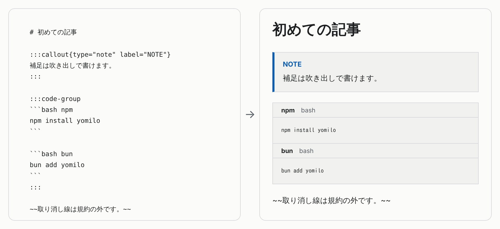
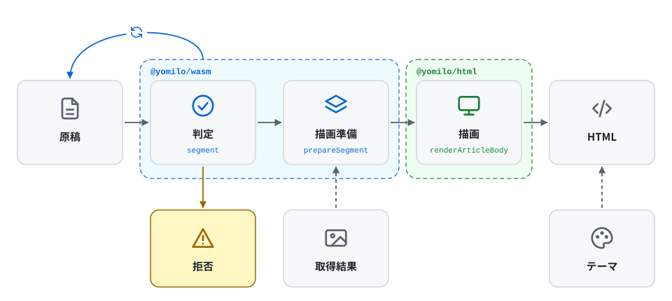

<p align="center">
  <br>
  <br>
  <picture>
    <source media="(prefers-color-scheme: dark)" srcset="../../assets/logo-dark.svg">
    <source media="(prefers-color-scheme: light)" srcset="../../assets/logo-light.svg">
    
  </picture>
  <br>
</p>
<p align="center">
  <a href="https://github.com/RateteDev/yomilo/releases/latest"></a>
  <a href="../../LICENSE"></a>
</p>
<p align="center">
  <a href="../../README.md">日本語</a> ・ English
</p>
<br/>

# Yomilo

For developers who show AI agent output or articles on screen, Yomilo turns strict Markdown into readable HTML.
It renders a draft that is still being written, one confirmed element at a time.

- 🧱 Sets aside only the broken elements and keeps rendering the rest
- ⚡ Shows confirmed elements in order from a draft that is still being generated
- 🧩 Writes callouts, code groups, figures, images, videos, and link cards as directives
- 🎨 Ships the body HTML and the theme separately
- 🦀 Wraps a Rust core in WASM to run on Node, Bun, Workers, and browsers

## Problems it solves

| Problem | Yomilo's answer |
| --- | --- |
| AI output varies in syntax, and one broken spot can break the whole page | Checks element by element and rejects only the broken element |
| Readers want to see text before generation finishes | Renders confirmed elements in order, and a rendered element stays as it is when more text arrives |
| Readers want richer expressions than standard Markdown offers | Writes callouts, code groups, figures, images, videos, and link cards as directives |
| The look belongs to the consumer | Returns only the body HTML and ships the theme separately |

## Example

<p align="center">
  <picture>
    <source media="(prefers-color-scheme: dark)" srcset="../../assets/example-dark.png">
    <source media="(prefers-color-scheme: light)" srcset="../../assets/example-light.png">
    
  </picture>
</p>

The strikethrough line is outside the rules, so it is set aside as its original text, and the other elements render neatly.

## How it works

<p align="center">
  <picture>
    <source media="(prefers-color-scheme: dark)" srcset="../../assets/how-it-works-dark.svg">
    <source media="(prefers-color-scheme: light)" srcset="../../assets/how-it-works-light.svg">
    
  </picture>
</p>

1. **Check** (`segment`): splits the source into one segment per top-level element and returns the confirmed ones.
2. **Prepare** (`prepareSegment`): adds fetched images and cards and the roles of code colors to each segment.
3. **Render** (`renderArticleBody`): builds the body HTML from the segments and returns the title, headings, and diagnostics.

The vocabulary is defined in the [glossary](../用語集.md) (Japanese).

## Installation

Packages are distributed as tarballs on [GitHub Releases](https://github.com/RateteDev/yomilo/releases).

```sh
# Install the WASM core and the HTML renderer (match the latest release; v0.1.0 is an example)
bun add https://github.com/RateteDev/yomilo/releases/download/v0.1.0/yomilo-wasm-0.1.0.tgz https://github.com/RateteDev/yomilo/releases/download/v0.1.0/yomilo-html-0.1.0.tgz
# Install the minimal theme CSS when you use it
bun add https://github.com/RateteDev/yomilo/releases/download/v0.1.0/yomilo-theme-0.1.0.tgz
```

## Usage

```ts
import { renderArticleBody } from "@yomilo/html/engine";
import { defaultPreparationInputs, prepareSegment, segment } from "@yomilo/wasm";

const source = await Bun.file("article.md").text();
// Check: split the source into one segment per top-level element
const { segments } = segment(source, null, "complete");
// Prepare: use the default inputs, whose fetched results are empty
const inputs = defaultPreparationInputs();
// Render: get the body HTML, title, headings, and diagnostics
const { html, title, diagnostics } = renderArticleBody(segments.map((s) => prepareSegment(s, inputs)));
```

`@yomilo/html` ships TypeScript sources, so use it in an environment that handles TypeScript, such as Bun or a bundler.
It returns only the body HTML, so the consumer is free to add CSS, interactions, a table of contents, and a page frame.
Loading the WASM on Workers and in browsers is described in a [separate document](../WorkersとブラウザでのWASM.md) (Japanese).

## Theme

`@yomilo/theme/minimal.css` is a minimal theme that applies directly to the body HTML.
It uses the system fonts and supports both light and dark colors.

## Syntax

Write the source in strict Markdown.

- Headings (h1 to h3), paragraphs, emphasis, inline code, links, bulleted and numbered lists, quotes, tables, code, and thematic breaks are available.
- Callouts, code groups, figures, images, videos, and link cards are written as directives.
- An element with a footnote, strikethrough, a task list, Markdown image syntax, or raw HTML comes back as a rejected segment with its source and diagnostics, and the other elements keep rendering.

## License

[MIT License](../../LICENSE)
